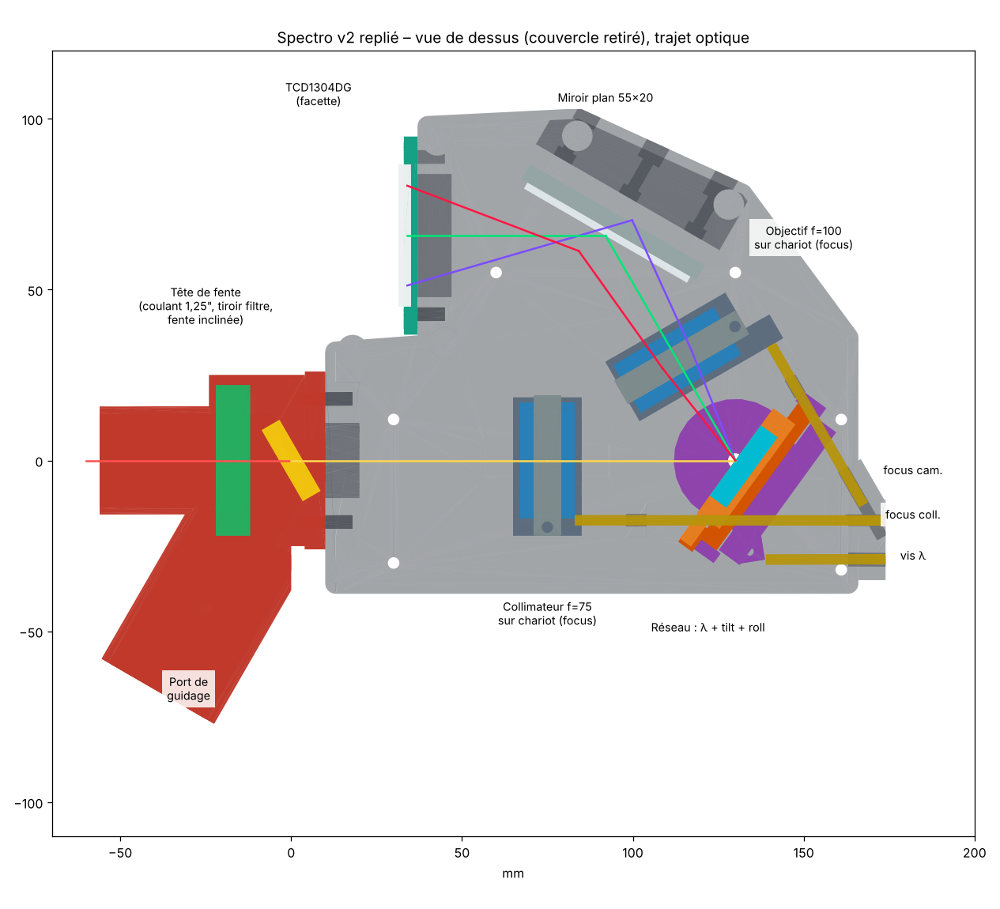

# Spectro — spectroscope astronomique à capteur linéaire TCD1304DG

Spectroscope à réseau de diffraction pour petite lunette (conçu pour une 80/480, f/6). Il sert à enregistrer des spectres d'étoiles et à mesurer la courbe de transmission de filtres. Le boîtier s'imprime en 3D (FDM). Les réseaux et les fentes sont interchangeables.



## Caractéristiques

- **Optique** : réseau plan en réflexion, déviation fixe de 60°, collimateur achromat f = 75 mm, objectif achromat f = 100 mm, miroir plan de renvoi.
- **Réseaux** : interchangeables (disques porte-réseau tenus par aimants), 300 à 1200 traits/mm.
  - 300 t/mm : tout le spectre visible en une pose, 0,25 nm/px, R ≈ 700 (fente de 25 µm).
  - 1200 t/mm : fenêtre de 240 nm, 0,067 nm/px, R ≈ 3 500 à 4 300.
- **Fentes** : cassettes interchangeables de 15 à 100 µm. La fente est inclinée pour renvoyer le champ vers un port de guidage.
- **Réglages** accessibles de l'extérieur :
  - mise au point du collimateur et de l'objectif ;
  - longueur d'onde (rotation du réseau) ;
  - tilt et orientation des traits du réseau ;
  - miroir de renvoi et capteur (3 vis chacun).
- **Capteur** : Toshiba TCD1304DG (3648 pixels de 8 × 200 µm), piloté par un Raspberry Pi Pico. Un Raspberry Pi Zero 2 W fait l'affichage.
- **Autonomie** : compartiment sous le plancher avec 2 accus 18650, le Pico, le Pi Zero et un ventilateur. Environ 8 h d'autonomie.

## Contenu du dépôt

| Dossier | Contenu |
| --- | --- |
| [`docs/`](docs) | Dossier de conception complet (`dossier_conception.pdf`) et images (vues 3D, schéma électronique) |
| [`optique/`](optique) | `optique.py` : bilan optique (plage couverte, dispersion, résolution par réseau et par fente) |
| [`mecanique/v2/`](mecanique/v2) | Version actuelle : modèle paramétrique CadQuery `spectro_v2.py`, vérifications, **24 STL à imprimer** et STEP d'assemblage (`export_v2/`) |
| [`mecanique/v1/`](mecanique/v1) | Première version (sans miroir ni réglages de mise au point), gardée pour comparaison |
| [`logiciel/`](logiciel) | Électronique et logiciel : firmware MicroPython du Pico, pilote Python, interface graphique PyQt5, schéma électronique — voir [`logiciel/README.md`](logiciel/README.md) |

## Démarrage rapide

### Imprimer le spectro

Les fichiers à imprimer sont dans `mecanique/v2/export_v2/` (fichiers `01_` à `24_`). Imprimer en PETG ou en ASA noir mat, avec 4 périmètres et 40 % de remplissage gyroïde. Le jeu d'impression de 0,25 mm est déjà inclus. L'orientation conseillée pour chaque pièce est indiquée dans le dossier de conception.

### Régénérer ou modifier la mécanique

```bash
pip install -r requirements-cad.txt
cd mecanique/v2
python3 spectro_v2.py        # régénère export_v2/*.stl et le STEP
python3 check_v2.py          # collisions sur toute la plage de rotation et de mise au point
python3 run_checks_v2.py     # aucun faisceau coupé
```

Tous les paramètres sont regroupés en tête de `spectro_v2.py` : focales, angles, jeux d'impression, dimensions du compartiment électronique.

### Bilan optique

```bash
cd optique && python3 optique.py
```

### Électronique et logiciel d'acquisition

Voir [`logiciel/README.md`](logiciel/README.md) : schéma, câblage, installation du firmware sur le Pico et de l'interface sur le Pi Zero. Pour tester l'interface sans matériel :

```bash
pip install -r logiciel/requirements.txt
python3 logiciel/rpi/spectro_gui.py --sim
```

## État du projet

- La mécanique a été vérifiée par calcul (interférences entre pièces, trajet des faisceaux), mais n'a pas encore été imprimée.
- Le firmware et le schéma ont été vérifiés par émulation et par calcul, mais pas encore sur un montage réel.
- La commande du ventilateur par le Pi Zero (MOSFET sur un GPIO, arrêt pendant les acquisitions) est décrite dans le dossier de conception, mais n'est pas encore codée dans l'interface.
