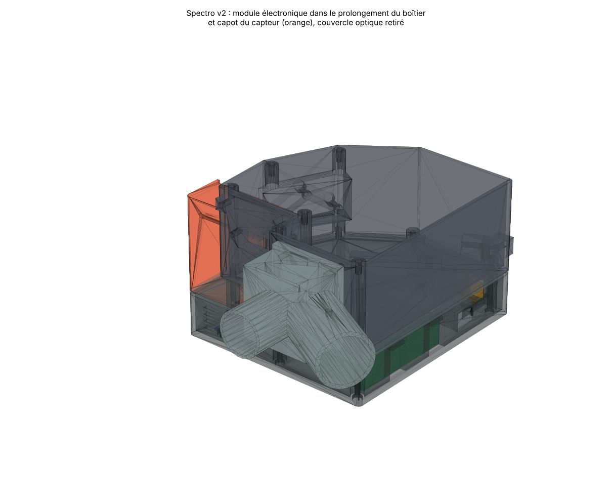
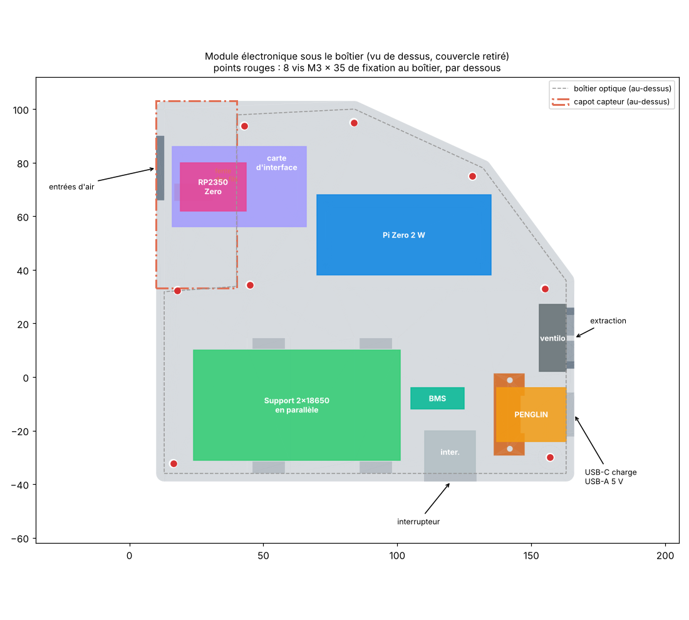

# Alimentation et module électronique





## Architecture mécanique

Le module électronique est **dans le prolongement du boîtier optique**, en dessous : son bac
(pièce 23) reprend exactement le contour du boîtier, zone du capteur comprise, et se plaque
directement sous son plancher, qui le ferme. Il n'y a pas de couvercle séparé.
Le spectro complet mesure 156 × 142 × 98 mm, tête de fente non comprise.

- **Bac (23)** : tous les composants sont vissés ou sanglés sur son fond.
- **Fixation** : 8 vis M3 × 30 introduites **par dessous**, têtes noyées, traversent les colonnes
  du bac et se vissent dans 8 inserts M3 du boîtier. On démonte l'électronique sans ouvrir l'optique.
- **Capot du capteur (25)** : il ferme la zone du capteur, sur la façade, de son fond (posé sur le
  bac) jusqu'au dessus du boîtier, et affleure ses faces. Son fond ferme le bac sous la zone du
  capteur ; les fils de la carte capteur y descendent par une fente et sont protégés sur toute leur
  longueur. Il tient par 2 vis M3 × 25 (face avant) dans deux bossages de la facette, au-dessus
  de la plaque du capteur. On l'enlève pour régler le capteur (3 vis de la plaque 17).

## Principe

Deux accus 18650 **en parallèle** forment une seule cellule de 3,7 V d'environ 7 Ah (25 Wh).
Le module PENGLIN la charge par USB-C (2,4 A, environ 3 h 30) et en tire du 5 V (2 A maximum).

```
            ┌──────────── BMS 1S 6 A ────────────┐
 2 × 18650 ─┤ B+  B−                    P+  P− ├── B+ / B− du module PENGLIN
 (parallèle)└────────────────────────────────────┘
                                   USB-C (face arrière) : charge
 PENGLIN ── USB-A (face arrière) : sortie 5 V auxiliaire (résistance anti-buée ≤ 0,8 A)
         └─ pastilles 5V+ / − ── interrupteur ── bus 5 V de la carte d'interface
                                                    ├─ Pi Zero : broche 2 (5 V) et 6 (GND)
                                                    └─ ventilateur (via MOSFET, GPIO18 du Pi)
 Pi Zero, port « USB » ── câble micro-USB ↔ USB-C ── RP2350-Zero (données + 5 V du capteur)
```

Consommation : Pi Zero 2 W 0,6 à 1,5 W, RP2350-Zero + capteur 0,3 à 0,5 W, ventilateur 0,3 W
(coupé pendant les poses). Avec environ 88 % de rendement du module : **9 à 14 h**.

## Nomenclature

| Élément | Référence conseillée | Remarque |
| --- | --- | --- |
| Accus | 2 × Samsung INR18650-35E (3450 mAh, sans protection) | même lot, même tension avant de les relier |
| Support | Support 2 × 18650 (environ 77 × 41 × 20 mm) | **recâbler en parallèle** : + avec +, − avec − |
| Protection | Carte BMS 1S « 12A » DW01 + 8205, 35 × 7,4 × 2 mm (6 A continu, coupure 7,5 A, 4,25 V / 2,45 V) | indispensable avec des accus sans protection ; une 3 A est trop juste (pointe ≈ 3,8 A à 2 A de sortie) |
| Chargeur / boost | Module PENGLIN USB-C / USB-A 5 V 2 A (carte 25 × 20 mm) | cavalier de charge sur **4,2 V** (pas 4,35 V) |
| Interrupteur | Interrupteur à bascule, découpe 19,5 × 13,5 mm (KCD1 ou équivalent) | coupe le 5 V interne |
| Sangles | 2 sangles velcro de 10 mm, ou 2 colliers | passent dans les fentes des montants, par-dessus le support |
| Fixation du module | 8 vis M3 × 30 tête cylindrique + 8 inserts M3 (les mêmes que le reste du boîtier) | inserts posés par dessous dans le boîtier |
| Capot capteur | Pièce imprimée `25_capot_capteur` + 2 vis M3 × 25 + 2 inserts M3 | |
| Câble capteur | Câble 7 fils souple (nappe ou fils torsadés) + connecteur Dupont/JST sur la carte d'interface | débrancher pour déposer le module |
| Bride | Pièce imprimée `24_bride_penglin` + 2 vis M2 × 6 autotaraudeuses | vissée par dessus |
| Carte d'interface | Plaque à pastilles 50 × 30 mm, 4 vis M2 × 6 | RP2350-Zero sur 2 barrettes femelles |
| Ventilateur | 25 × 25 × 10 mm, 5 V | MOSFET AO3400 ou 2N7000, voir `logiciel/serveur/README.md` |

## Montage

1. **Inserts** : poser à chaud les 8 inserts M3 sous le boîtier (bas des colonnettes et des deux
   bossages arrière) et les 2 inserts des bossages du capot, sur la facette du capteur.
2. **Accus** : vérifier que les deux accus sont à la même tension (à 0,05 V près) avant de les
   mettre dans le support recâblé en parallèle. Souder la carte BMS sur les fils du support
   (B+ / B−) et la coller à côté du support. Ses sorties P+ / P− vont aux pastilles B+ / B− du
   module PENGLIN.
3. **Support d'accus** : le poser au fond du bac et le plaquer avec les deux sangles, qui passent
   dans les fentes des montants par-dessus le support.
4. **Module PENGLIN** : vérifier le cavalier 4,2 V. Le poser **composants vers le bas** (prise USB-A
   au-dessus) sur les rebords des rails, prises contre la face arrière, puis visser la bride par
   dessus (pièce 24). Son bord bute contre le corps de la prise USB-A : la carte ne recule pas quand on enfiche
   une fiche.
5. **Câblage 5 V** : pastilles 5V+ / − du module → interrupteur (face −y) → bus 5 V de la carte
   d'interface → broches 2 et 6 du Pi Zero (fils de 0,5 mm², courts).
6. **Carte d'interface** : y souder les deux barrettes femelles de la RP2350-Zero, le MOSFET du
   ventilateur et un connecteur 7 broches pour le câble du capteur. La visser sur ses 4 entretoises,
   près de la face avant, sous la fente des fils ; enficher la RP2350-Zero par dessus, USB-C vers
   le Pi Zero.
7. **Pi Zero** : le visser sur ses 4 entretoises (M2,5). Câble court micro-USB (OTG) ↔ USB-C entre
   son port « USB » et la RP2350-Zero.
8. **Ventilateur** : le visser contre la face arrière (4 vis M2,5 ou autotaraudeuses), en extraction.
9. **Fixation** : présenter le bac sous le boîtier et serrer les 8 vis M3 × 30 par dessous.
10. **Capteur** : passer le câble du capteur par la fente du fond du capot 25, le brancher sur la
    carte capteur et sur la carte d'interface, régler le capteur, puis poser le capot (2 vis M3 × 25
    en face avant). Garnir la fente d'un peu de mousse noire autour du câble : les LED du bac ne
    doivent pas éclairer la zone du capteur.

Pour déposer l'électronique : enlever le capot 25, débrancher le câble du capteur, dévisser les
8 vis du dessous ; le bac descend d'un bloc avec tous les composants.

## Précautions

- Ne pas recharger sous 0 °C : par nuit froide, laisser le spectro se réchauffer avant de le brancher.
- Le module peut couper sa sortie un instant quand on branche ou débranche le chargeur, ce qui
  redémarre le Pi Zero : éviter de le faire pendant une observation. Pour charger en observant,
  le remplacer par une Adafruit PowerBoost 1000C (partage de charge, charge à 1 A seulement).
- Courant total limité à 2 A : la résistance anti-buée branchée sur l'USB-A ne doit pas dépasser 0,8 A.
- Si la sortie USB-A ne démarre pas seule quand on y branche la résistance, appuyer brièvement sur
  le bouton du module (pastilles « K »), ou laisser l'interrupteur interne sur marche.
