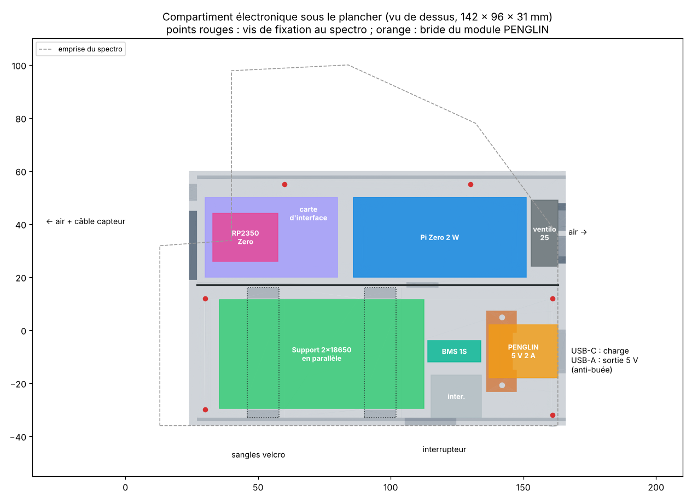
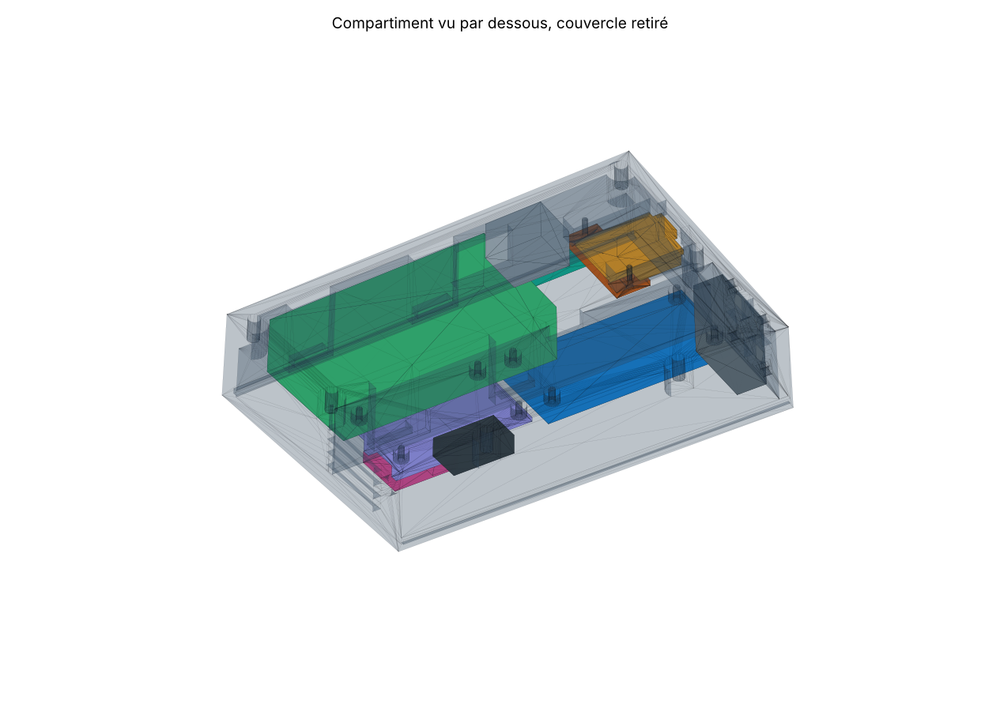

# Alimentation et compartiment électronique





## Principe

Deux accus 18650 **en parallèle** forment une seule cellule de 3,7 V d'environ 7 Ah (25 Wh).
Le module PENGLIN la charge par USB-C (2,4 A, environ 3 h 30) et en tire du 5 V (2 A maximum).

```
            ┌──────────── BMS 1S 6 A ────────────┐
 2 × 18650 ─┤ B+  B−                    P+  P− ├── B+ / B− du module PENGLIN
 (parallèle)└────────────────────────────────────┘
                                   USB-C (face arrière) : charge
 PENGLIN ── USB-A (face arrière) : sortie 5 V auxiliaire (résistance anti-buée ≤ 0,8 A)
         └─ pastilles 5V+ / − ── interrupteur ── bus 5 V de la carte d'interface
                                                    ├─ Pi Zero : broche 2 (5 V) et 6 (GND)
                                                    └─ ventilateur (via MOSFET, GPIO18 du Pi)
 Pi Zero, port « USB » ── câble micro-USB ↔ USB-C ── RP2350-Zero (données + 5 V du capteur)
```

Consommation : Pi Zero 2 W 0,6 à 1,5 W, RP2350-Zero + capteur 0,3 à 0,5 W, ventilateur 0,3 W
(coupé pendant les poses). Avec environ 88 % de rendement du module : **9 à 14 h**.

## Nomenclature

| Élément | Référence conseillée | Remarque |
| --- | --- | --- |
| Accus | 2 × Samsung INR18650-35E (3450 mAh, sans protection) | même lot, même tension avant de les relier |
| Support | Support 2 × 18650 (environ 77 × 41 × 20 mm) | **recâbler en parallèle** : + avec +, − avec − |
| Protection | Carte BMS 1S « 12A » DW01 + 8205, 35 × 7,4 × 2 mm (6 A continu, coupure 7,5 A, 4,25 V / 2,45 V) | indispensable avec des accus sans protection ; une 3 A est trop juste (pointe ≈ 3,8 A à 2 A de sortie) |
| Chargeur / boost | Module PENGLIN USB-C / USB-A 5 V 2 A (carte 25 × 20 mm) | cavalier de charge sur **4,2 V** (pas 4,35 V) |
| Interrupteur | Interrupteur à bascule, découpe 19,5 × 13,5 mm (KCD1 ou équivalent) | coupe le 5 V interne |
| Sangles | 2 sangles velcro de 10 mm, ou 2 colliers | passent dans les fentes des montants |
| Bride | Pièce imprimée `25_bride_penglin` + 2 vis M2 × 6 autotaraudeuses | |
| Carte d'interface | Plaque à pastilles 50 × 30 mm, 4 vis M2 × 6 | RP2350-Zero sur 2 barrettes femelles |
| Ventilateur | 25 × 25 × 10 mm, 5 V | MOSFET AO3400 ou 2N7000, voir `logiciel/serveur/README.md` |

## Montage

1. **Accus** : vérifier que les deux accus sont à la même tension (à 0,05 V près) avant de les
   mettre dans le support recâblé en parallèle. Souder la carte BMS sur les fils du support
   (B+ / B−), la coller sur le petit côté du support d'accus (face vers le module PENGLIN).
   Ses sorties P+ / P− vont aux pastilles B+ / B− du module PENGLIN.
2. **Support** : le plaquer au plafond avec les deux sangles qui passent dans les fentes des montants.
3. **Module PENGLIN** : vérifier le cavalier 4,2 V. Le glisser entre les rails, connecteurs
   contre la face arrière, puis visser la bride 25 par dessous. Son bord bute contre le corps de
   la prise USB-A : la carte ne recule pas quand on enfiche une fiche.
4. **Câblage 5 V** : pastilles 5V+ / − du module → interrupteur → bus 5 V de la carte d'interface
   → broches 2 et 6 du Pi Zero (fils de 0,5 mm², courts). Le passage de fils est dans la cloison.
5. **Carte d'interface** : y souder les deux barrettes femelles de la RP2350-Zero, le MOSFET du
   ventilateur et le départ du câble 7 fils vers la carte capteur (trou de la face avant).
   La visser sur ses 4 entretoises, la RP2350-Zero enfichée par dessous, USB-C vers le Pi Zero.
6. **Liaison** : câble court micro-USB (OTG) ↔ USB-C entre le port « USB » du Pi Zero et la RP2350-Zero.

## Précautions

- Ne pas recharger sous 0 °C : par nuit froide, laisser le spectro se réchauffer avant de le brancher.
- Le module peut couper sa sortie un instant quand on branche ou débranche le chargeur, ce qui
  redémarre le Pi Zero : éviter de le faire pendant une observation. Pour charger en observant,
  le remplacer par une Adafruit PowerBoost 1000C (partage de charge, charge à 1 A seulement).
- Courant total limité à 2 A : la résistance anti-buée branchée sur l'USB-A ne doit pas dépasser 0,8 A.
- Si la sortie USB-A ne démarre pas seule quand on y branche la résistance, appuyer brièvement sur
  le bouton du module (pastilles « K »), ou laisser l'interrupteur interne sur marche.
